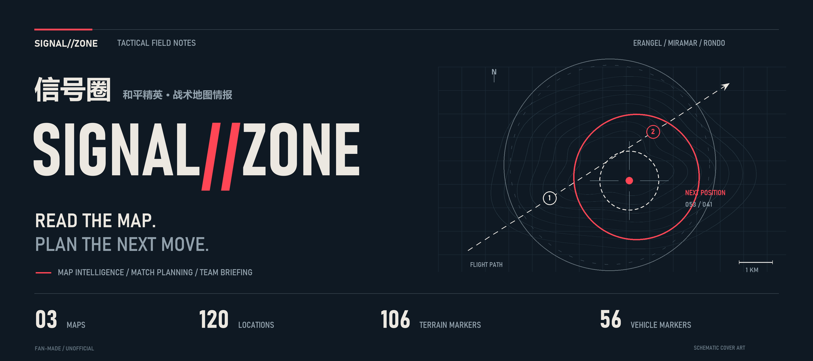
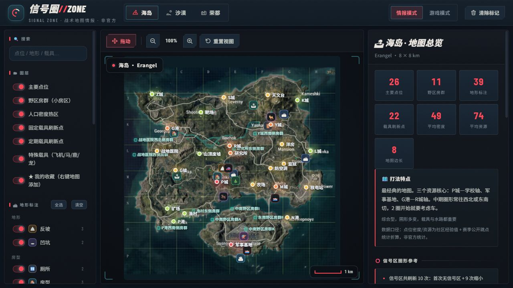
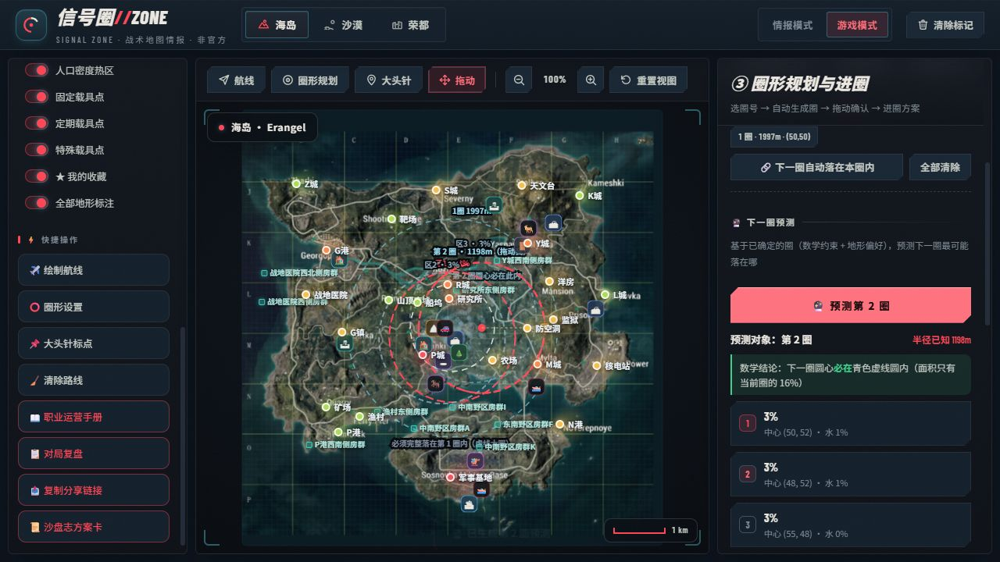
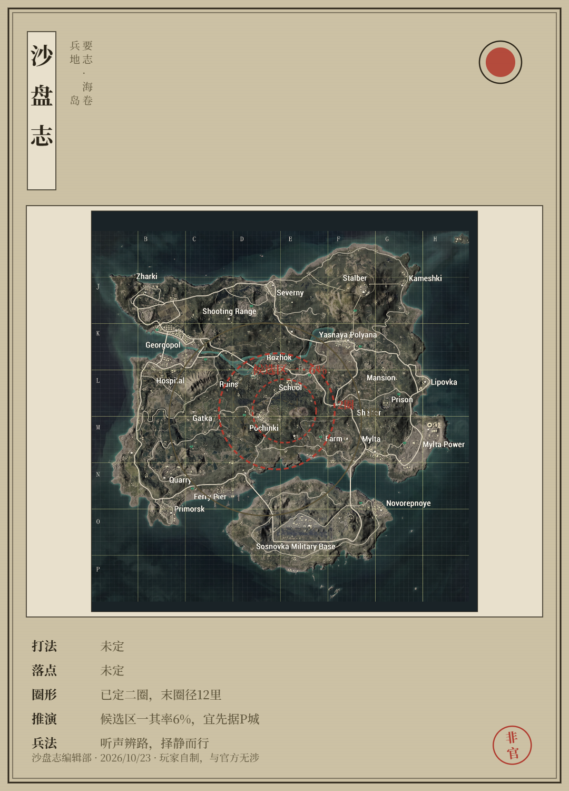

<div align="center">



# SIGNAL//ZONE · 信号圈

**Read the map. Plan the next move.**

A tactical map desk for Game for Peace players.<br />
Explore terrain, plan drops and rotations, and bring your squad onto the same map.

[简体中文](README.md) · [English](README.en.md)


[Preview](#preview) · [Capabilities](#capabilities) · [Get started](#get-started) · [Data and limits](#data-and-limits) · [Developer guide](docs/ARCHITECTURE.md)

</div>

---

### One map. A whole match of decisions.

**SIGNAL//ZONE** connects map intelligence and match planning: examine resources and terrain, draw a flight path, mark a drop, explore possible zones, and share the resulting plan.

Use it for pre-match discussion, a second-screen reference, or post-match review. Navy black, warm white, and signal red organize the interface while preserving the map's original colors. **The application interface is currently in Chinese.**

| Map | Locations & compounds | Terrain markers | Vehicle markers |
| :--- | ---: | ---: | ---: |
| Erangel · 海岛 | 37 | 39 | 22 |
| Miramar · 沙漠 | 51 | 25 | 16 |
| Rondo · 荣都 | 32 | 42 | 18 |
| **Current dataset** | **120** | **106** | **56** |

<sub>Counts describe static records in this repository. They do not represent live spawns, player positions, or exhaustive map coverage.</sub>

### Preview

**01 / Intelligence desk** — Locations, terrain, vehicles, and regional context in one view.



**02 / Zone planning** — Place zones and drop markers on the map, then discuss the next rotation.



<details>
<summary><strong>03 / Field briefing: export a plan card</strong></summary>
<br />



A 1080 × 1500 PNG with a paper field-manual layout, available from the planning sidebar.

</details>

### Capabilities

| Stage | What you can do |
| :--- | :--- |
| **Intelligence** | Switch between three maps, search locations, combine compound, density, vehicle, and 19 terrain-category layers, and inspect tactical notes. |
| **Drop planning** | Choose a playstyle, draw a flight path, and inspect estimated congestion. Vehicle-first plans prioritize safety scores and may add an outlying compound when all suggested towns are risky. |
| **Rotation** | Mark a landing point, drag zones from inside the circle, resize with a handle, and review nearby place names, route suggestions, timing, and squad roles. |
| **Zone scenarios** | Sample 600 candidate centers within a geometric constraint and score them using water, resources, cover, and movement factors. |
| **Sharing** | Restore the same map, flight path, zones, and pin through a share link, or export a field briefing as a PNG. |
| **Review** | Save observed circles, review retrospective candidate-region hits and distance errors, and experiment with local weight adjustments after enough adjacent-circle samples. |

Also includes a strategy playbook, personal bookmarks, procedural 360° terrain illustrations, marker decluttering, viewport culling, and keyboard zoom controls.

### Plan a match in four steps

1. **Choose a style and draw the flight path.** Compare suggested drops and modeled congestion.
2. **Pick a landing point and locate vehicles.** Use a recommendation or place a custom pin.
3. **Confirm zones and discuss rotations.** Drag reference circles into position, then inspect scenario regions and route suggestions.
4. **Assign roles and share the plan.** Copy a planning link or export a briefing card for your squad.

### Get started

Use a modern desktop browser and either Python 3 or Node.js. Serve the files over HTTP to support map-pixel access and PNG export.

```bash
git clone https://github.com/Jul11us/signal-zone.git
cd signal-zone
python -m http.server 8642 --bind 127.0.0.1
```

Open **[http://127.0.0.1:8642](http://127.0.0.1:8642)**.

<details>
<summary>Start with Node.js instead</summary>

```bash
npx http-server -p 8642 -c-1 -a 127.0.0.1
```

The first run may download `http-server` from npm.

</details>

There are no application dependencies, frontend build steps, or backend configuration. Google Fonts requires an internet connection; system fonts provide a fallback.

| Action | Shortcut |
| :--- | :--- |
| Zoom in / out | `+` / `-` |
| Reset map view | `0` |
| Leave the drawing tool | `Esc` |
| Add a bookmark | Right-click the map |

### Data and limits

**Zone scenarios support discussion.** Candidate regions use heuristic scoring, and displayed scores are relative model weights. Accuracy has not been validated against real matches. Reference radii include PUBG PC measurements and estimates; geometric constraints depend on those parameters and the supplied circles. They cannot guarantee the next mobile-game zone. Congestion is also a static estimate.

Locations, resource ratings, vehicles, and tactical notes are curated reference data and may change with game updates. The playbook explains strategy concepts rather than current official competition rules. The bundled 360° views are procedural illustrations; terrain photographs are not included. See the [asset directory instructions](assets/terrain/README.txt) to add your own images.

**Your records stay in your browser.** Bookmarks, review samples, and calibration weights use `localStorage`; the current application has no account system or application backend. Clearing site data removes these local records. Share links encode planning state in the URL: anyone with a link can read and restore it. Encoding is not encryption.

Links using `localhost` or `127.0.0.1` point to the recipient's own computer. To share across devices, use a deployed address that your squad can reach. The application warns when a copied link uses a local address.

### Development and assets

Built with native HTML, CSS, JavaScript, and Canvas 2D. See the **[developer guide](docs/ARCHITECTURE.md)** for file responsibilities, model parameters, verification commands, and terrain-image extensions.

This is an unofficial fan project, with no affiliation with or endorsement by Game for Peace, Tencent, or the relevant game rights holders. Game maps and trademarks belong to their respective owners. No open-source grant covering third-party assets is declared. See [asset and rights notes](NOTICE.md).

---

<div align="center">
<sub><strong>SIGNAL//ZONE</strong> · MAP INTELLIGENCE / DROP PLANNING / ZONE SCENARIOS</sub><br />
<sub>Read the map. Plan the next move.</sub>
</div>
